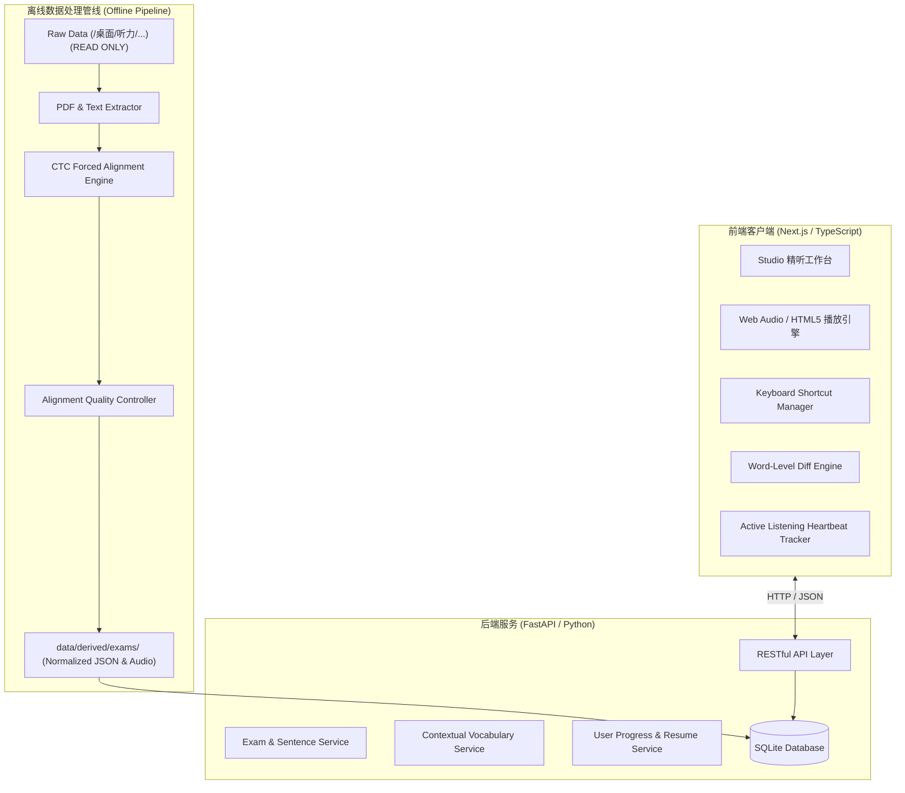

# SixSense 系统架构设计说明书 (ARCHITECTURE.md)

> **设计核心原则**：
> 1. **Local-First & Zero-Bloat**：本机极速启动，零外部重型依赖（无 Redis、无 Kafka、无微服务集群）。
> 2. **Raw/Processed 严格物理隔离**：原始用户资料目录只读映射，衍生数据统一落盘至 `data/derived/`。
> 3. **极简全栈协同**：Next.js (App Router, React 19, TypeScript, Tailwind CSS) 前端交互 + FastAPI / SQLite 纯净数据服务。

---

## 1. 系统总体拓扑结构



---

## 2. 技术栈选型与权衡 (Tech Stack Evaluation)

| 层级 | 选用技术 | 选型理由与对比权衡 |
| :--- | :--- | :--- |
| **前端框架** | **Next.js (App Router) + React + TypeScript** | 现代桌面端 Web 首选，首屏渲染快，强类型保障；组件状态机清晰管理句子切换与循环。 |
| **样式与主题** | **Tailwind CSS + CSS Variables** | 毫秒级 Dark Mode / Light Mode 切换，极简学术风调色板，杜绝复杂 CSS 文件臃肿。 |
| **音频播放引擎** | **HTML5 Audio + Web Audio API (高精度微调)** | 精确控制播放起止 `currentTime`，支持无缝单句循环、平滑淡入淡出（避免切音噼啪爆音）、变速不变调。 |
| **后端 API 服务** | **FastAPI (Python 3.13)** | 极速轻量，自带 Pydantic v2 数据模型验证与 OpenAPI 文档；天然便于调用 Python 音频与 NLP 库。 |
| **持久化存储** | **SQLite (WAL 模式)** | 单文件嵌入式存储，零维护成本，性能强悍，备份便捷；未来上云可无损迁移至 PostgreSQL。 |
| **句子级对齐管线** | **Torchaudio CTC Forced Alignment (wav2vec2)** | CPU 极速运行（25分钟音频 ~20秒完成对齐），单词级时间戳输出，零幻觉。 |

---

## 3. 音频流式传输与安全架构 (Audio Streaming)

1. **音频绝对不重复物理拷贝**：
   - 原始音频位于用户目录，后端通过流式分块路由（HTTP 206 Partial Content / Range Requests）提供支持。
   - 前端支持快速 Seek、跳转与预加载。
2. **环境变量可配置化 (No Hardcoded Paths)**：
   - 配置文件 `.env`：
     ```bash
     CET6_RAW_SOURCE_DIR=/home/stone/桌面/听力/01-六级历年真题及答案解析+听力音频
     SIX_SENSE_DATA_DIR=./data
     DATABASE_URL=sqlite:///./data/sixsense.db
     PORT=8000
     ```

---

## 4. 离线对齐质量控制门禁 (Alignment Quality Gate)

为保证生成的对齐时间戳达到“毫秒级精确，不吞首词，不拖尾音”，管线内置 QC 自动化校验：
- **Duration 异常检测**：单句时长 `< 0.3s` 或 `> 35s` 自动告警并截取复查；
- **Overlap 异常检测**：相邻两句 `end_time[i] > start_time[i+1] + 0.05s` 触发重叠修正；
- **Gap 异常检测**：句间异常大空白自动标注提示；
- **Confidence 门禁**：对齐置信度低于 0.85 的句子自动标记 `needs_manual_review: true`。
