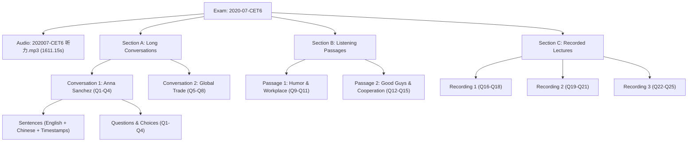

# SixSense - CET-6 数据资源审计报告 (DATA AUDIT)

> **审计执行时间**：2026-09-29  
> **审计目录**：`/home/stone/桌面/听力/01-六级历年真题及答案解析+听力音频/`  
> **数据访问权限**：STRICTLY READ-ONLY（未对原始资源执行任何修改、移动或重命名）  
> **总容量**：约 3.271 GB  
> **包含顶层目录**：20 个  

---

## 1. 顶层文件目录结构总览

原始资源包含以下 20 个顶层目录与分类：

| 目录名称 | 包含文件/子目录特征 | 听力音频 | 真题试卷 (PDF/Word) | 答案与解析 (PDF) |
| :--- | :--- | :---: | :---: | :---: |
| `1990年-2018年真题资料【合集】` | 包含 1990-2014 远古赠品压缩包，以及 2015-2018 逐年子目录 | 有 (18个MP3) | 有 (74个文档) | 有 (含解析) |
| `2019年06月CET6题+解+音频` | 标准 4 目录结构（真题PDF/真题Word/答案解析/听力音频） | 2 套 MP3 | 有 (PDF+Word) | 有 (PDF，纯图片扫描) |
| `2019年12月CET6题+解+音频` | 标准 4 目录结构 | 2 套 MP3 | 有 (PDF+Word) | 有 (PDF，排版空格碎裂) |
| `2020年07月CET6题+解+音频` | 疫情补考单独全套卷（全国实考 1 套听力） | **1 套 MP3** | 有 (PDF+Word) | **有 (优质原生文本，中英对照齐全)** |
| `2020年09月CET6题+解+音频` | 疫情延考单独全套卷（全国实考 1 套听力） | **1 套 MP3** | 有 (PDF+Word) | **有 (优质原生文本，中英对照齐全)** |
| `2020年12月CET6题+解+音频` | 标准 4 目录结构 | 2 套 MP3 | 有 (PDF+Word) | 有 (PDF，排版空格碎裂) |
| `2021年06月CET6题+解+音频` | 标准 4 目录结构 | 2 套 MP3 | 有 (PDF+Word) | 有 (英文完整，中文Identity-H缺字) |
| `2021年12月CET6题+解+音频` | 标准 4 目录结构 | 2 套 MP3 | 有 (PDF+Word) | 有 (OCR质量较差，单词拼写有杂质) |
| `2022年06月CET6题+解+音频` | 疫情实考 1 套听力 | 1 套 MP3 | 有 (PDF+Word) | 有 (解析PDF) |
| `2022年09月CET6题+解+音频` | 疫情实考 1 套听力 | 1 套 MP3 | 有 (PDF+Word) | 有 (部分答题核心句被框遮挡为~) |
| `2022年12月CET6题+解+音频` | 标准 4 目录结构 | 2 套 MP3 | 有 (PDF+Word) | 有 (扫描图片PDF) |
| `2023年03月CET6题+解+音频` | 疫情延考实考 1 套听力 | 1 套 MP3 | 有 (PDF+Word) | 有 (扫描图片PDF) |
| `2023年06月CET6题+解+音频` | 标准 4 目录结构 | 2 套 MP3 | 有 (PDF+Word) | 有 (扫描图片PDF) |
| `2023年12月CET6题+解+音频` | 标准 4 目录结构 | 2 套 MP3 | 有 (PDF+Word) | 有 (扫描图片PDF) |
| `2024年06月CET6题+解+音频` | 标准 4 目录结构 | 2 套 MP3 | 有 (PDF+Word) | 有 (扫描图片PDF) |
| `2024年12月CET6题+解+音频` | 散落于根目录，无 word 提示 | 2 套 MP3 | 有 (PDF暂不可检索) | 有 (扫描图片PDF) |
| `2025年06月CET6题+解+音频` | 散落于根目录 | 2 套 MP3 | 有 (可检索PDF) | 有 (扫描图片PDF) |
| `2025年12月CTE6题+解+音频` | 散落于根目录（文件夹有笔误CTE6） | 2 套 MP3 | 有 (可检索PDF) | 有 (扫描图片PDF) |
| `2026年06月CET6题+解+音频【新】` | 散落于根目录 | 2 套 MP3 | 有 (可检索PDF) | 有 (含OCR层，但存在字母错漏) |
| `赠：六级真题【一键打印版】` | 历年合并打印版试卷 | 无音频 | 3 个巨型合并PDF | 无听力原文 |

---

## 2. 文件格式及全局统计

通过递归遍历扫描，全目录所有文件扩展名统计如下：

- **PDF 文件 (`.pdf`)**：153 个（主要为试卷真题、一键打印版以及答案解析详解）
- **Word 文件 (`.docx` / `.doc`)**：63 个（其中 `.docx` 60 个，`.doc` 3 个，全为真题试卷题干与选项，**不含听力录音文本**）
- **音频文件 (`.mp3`)**：49 个（采样率均为 44.1 kHz，立体声，码率 128 kbps）
- **说明文本 (`.txt`)**：15 个（全国听力套卷说明、疫情改考提示、Word缺失提示）
- **压缩文件 (`.zip`)**：1 个（1990-2014 远古资料包）
- **图片文件 (`.png`)**：1 个（打印推广广告）

---

## 3. 全国 CET-6 听力考次与套卷客观规律（核心审计发现）

在深入检查 15 个 `.txt` 提示文件及历年试卷说明后，发现了关于六级真题听力的数据规律：

1. **全国听力音频实际套数限制**：
   - 绝大多数正常年份（如 2019、2021、2023、2024、2025、2026），全国官方**实考听力音频一共只有 2 套**（第 1 套与第 2 套）。
   - 考卷所谓的“第 3 套”，其听力试题和音频完全与第 1 套或第 2 套共用，仅阅读/写作不同或题目选项乱序。原始资料中均明确标注：`“提示：全国考试音频一共是2套，第3套试卷是和前面两套共用”`。
2. **疫情期间的特殊考次**：
   - 2020年07月、2020年09月、2022年06月、2022年09月、2023年03月：受疫情分散组考影响，全国每次**仅实考 1 套听力**，所有考场共用同一套听力音频。
3. **2016年改革分界线**：
   - 2016年06月之前为旧题型（短对话 + 复合式听写）。
   - 2016年06月至今为现行标准六级题型：
     - **Section A**: 长对话 2 篇（8 题，Q1-Q8）
     - **Section B**: 听力篇章 2 篇（7 题，Q9-Q15）
     - **Section C**: 讲座/讲话 3 篇（10 题，Q16-Q25）

---

## 4. 听力文本（Transcript）与翻译（Translation）可获得性深度分析

我们对全部 78 份“解析 / 详解”类 PDF 文件进行了文本流底层分析（使用 Poppler 底层工具和字体编码反编译）：

| 年份考次 | 英文原文质量 | 中文翻译质量 | 存在的问题与排版风险 | 可直接使用评级 |
| :--- | :--- | :--- | :--- | :--- |
| **2020年07月** | **极高 (100% 完整)** | **极高 (100% 完整)** | 采用全角字符排版，经 NFKC 归一化后 100% 洁净，中英逐句对应 | **S (Golden)** |
| **2020年09月** | **极高 (100% 完整)** | **极高 (100% 完整)** | 同样来自光速考研完整收录，中英文完整无乱码 | **S (Golden)** |
| **2021年06月** | 高 (英文完整) | 无 (乱码缺失) | 英文可解析，但中文部分内嵌字体未提供 ToUnicode 映射表，提取全为问号和乱码 | B |
| **2021年12月** | 中 (含 OCR 噪音) | 中 | OCR 识别质量低（如 `bwsed` 代替 `based`, `coaversatlon` 代替 `conversation`） | C |
| **2022年09月** | 较高 (有空缺) | 高 | 原排版中答案关键句使用特殊图层/黑底反白，导致 `pdftotext` 遗漏为 `~` 符号 | B- |
| **2023年~2025年** | 极低 (无文本层) | 极低 | 绝大多数解析为纯位图图片扫描件（ABBYY FineReader/Acrobat 扫描无 OCR 层） | D (需Whisper/OCR) |
| **2026年06月** | 较高 (含 OCR 瑕疵) | 较完整 | 包含 Acrobat OCR 文本，但有 OCR 字母混淆（如 `ω` 识别为 `to`，`car臼r` 识别为 `career`） | B- |
| **2017年~2018年** | 完整 | 完整 | 包含防爬虫 Gurmukhi 水印字符（如 `\u0a4e`），需特殊正则清洗后方可使用 | B+ |

---

## 5. 黄金数据集 (Golden Dataset) 决策推荐

经过严密审计，强烈推荐以下套卷作为首发验证的 **Golden Dataset**：

### 推荐候选：`2020年07月 CET-6`
- **入选理由 1（数据真实完备，无歧义）**：
  - 本考次为疫情单独考次，**全国实考仅 1 套听力**，不存在“第1套/第2套/第3套”音频错配或试题拼凑问题。
  - 音频文件：`202007-CET6 听力.mp3`（时长 26分51秒，采样率 44.1kHz，音质纯净，无爆音、无杂音）。
- **入选理由 2（官方权威中英对照文本 100% 洁净）**：
  - `2020.07英语六级考试全1套解析.pdf` 拥有完整的原生文字层。
  - **英文录音原文**：完整覆盖 Section A（2篇长对话）、Section B（2篇篇章）、Section C（3篇讲座），无任何 OCR 坏字，角色发言标注清晰（`１－Ｍ`、`２－Ｗ` 等）。
  - **中文参考译文**：`全文翻译` 板块拥有 1:1 逐句逐段的权威高质量中文对照。
  - **试题与精解**：Q1~Q25 题干、四个选项（A/B/C/D）、设题要点、答案精析全部完整。
- **入选理由 3（完全符合现行新大纲）**：
  - 属于 2016 年改革后的现行六级体裁（Section A / B / C），模型建立后可无缝复用到后续所有现代年份。

---

## 6. 音频、原文、翻译、题目的关联逻辑图

在 2020-07 资料中，各实体之间的映射关系极其严谨：

